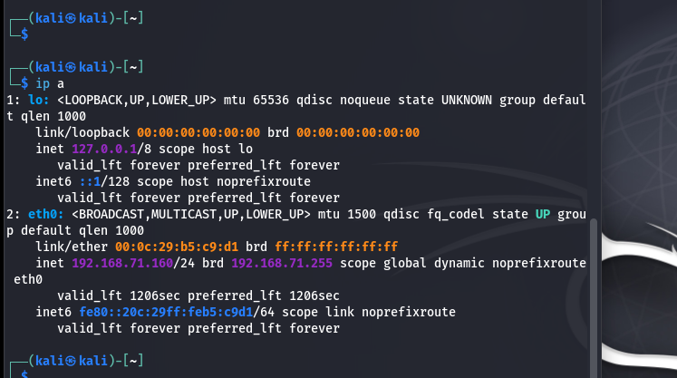
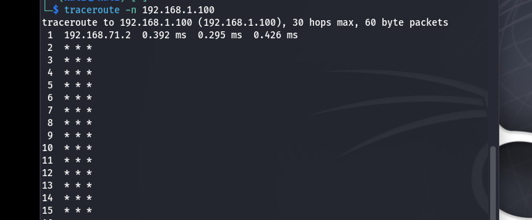
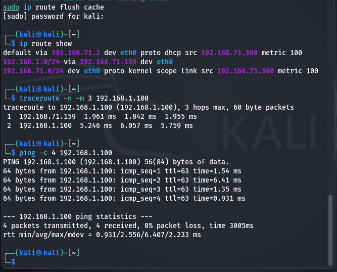
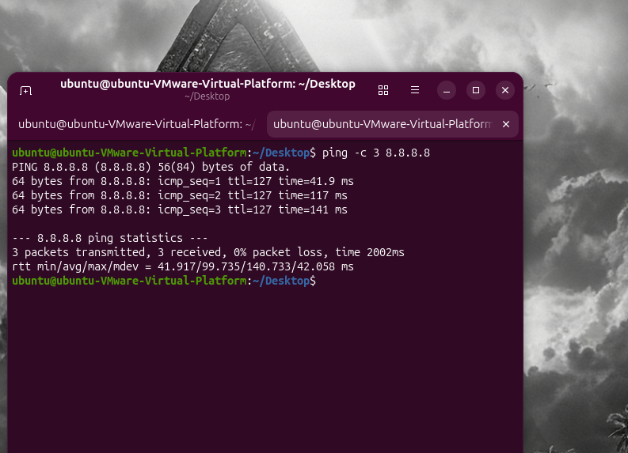
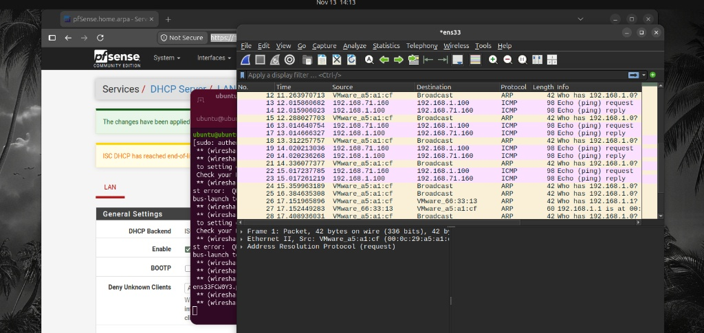
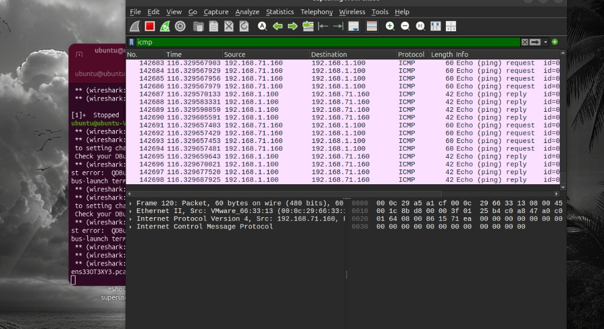
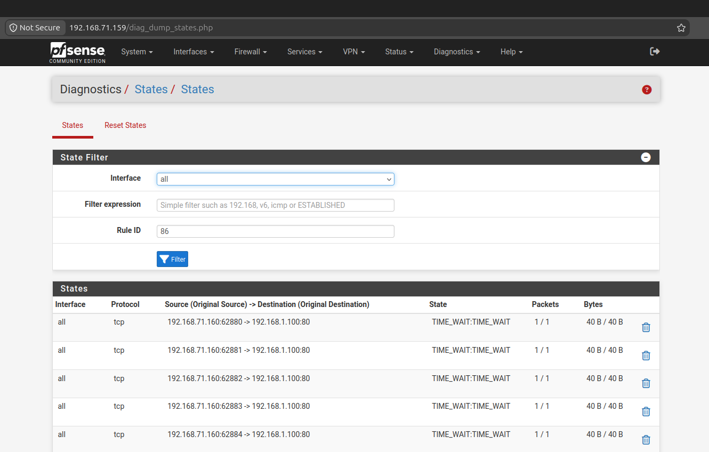
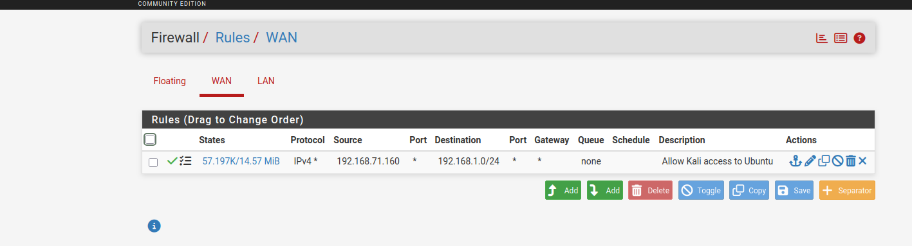
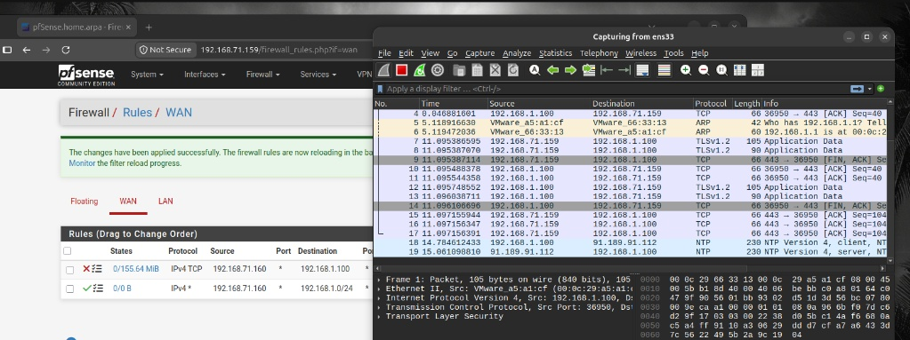

# pfSense Network Firewall & DoS Mitigation Lab (pfSense, Kali Linux, Ubuntu, Wireshark)

## Project Overview
I built this virtual network security lab in VMware Workstation to test how a stateful perimeter firewall (**pfSense CE 2.7.2**) handles Denial-of-Service (DoS) floods in real time. The lab places an external **Kali Linux** machine on a simulated WAN network (`192.168.71.0/24`) and an internal **Ubuntu Desktop** workstation on an isolated LAN segment (`192.168.1.0/24`) behind pfSense.

Beyond setting up firewall rules, this project documents how I diagnosed and fixed a subnet routing conflict with my local host network using `traceroute` and persistent static routing in Linux NetworkManager, analyzed live ICMP and TCP Port 80 SYN floods (`hping3`) in **Wireshark**, and configured a top-priority WAN Block rule that dropped **155.64 MiB** of flood traffic at the perimeter with zero attack packets reaching the internal LAN.

---

## Lab Network Topology & IP Table

| Virtual Machine | Role | Interface | IP Address / Subnet | Network & Gateway Details |
| :--- | :--- | :--- | :--- | :--- |
| **Kali Linux** | External Attacker | `eth0` | `192.168.71.160/24` | VMware NAT (WAN). Permanent static route: `192.168.1.0/24 via 192.168.71.159` |
| **pfSense CE 2.7.2** | Perimeter Firewall | `em0` (WAN) / `em1` (LAN) | `192.168.71.159/24` / `192.168.1.1/24` | WAN on VMware NAT; LAN on isolated internal segment with DHCP Server enabled |
| **Ubuntu Desktop** | Internal Target | `ens33` | `192.168.1.100/24` | Isolated internal LAN segment (`Default Gateway: 192.168.1.1`) |

---

## Step-by-Step Implementation & Lab Evidence

### 1. Attacker Network Setup & Fixing the Routing Conflict
First, I verified the `eth0` interface IP (`192.168.71.160/24`) on Kali Linux:

    ip a

When I initially tried to reach the Ubuntu machine (`192.168.1.100`), the pfSense WAN rules showed `0/0 B` states. Running `traceroute -n 192.168.1.100` showed that packets were going to the default VMware NAT gateway (`192.168.71.2`) instead of pfSense because my physical host network already used `192.168.1.0/24`:

To fix this, I added a static route pointing `192.168.1.0/24` to the pfSense WAN interface (`192.168.71.159`) and saved it in Kali's NetworkManager IPv4 settings so it persists across reboots:

    sudo ip route replace 192.168.1.0/24 via 192.168.71.159 dev eth0
    sudo ip route flush cache
    traceroute -n -m 3 192.168.1.100
    ping -c 4 192.168.1.100

---

### 2. Internal LAN DHCP & Outbound NAT Verification
On the internal LAN segment (`192.168.1.1/24`), pfSense leased `192.168.1.100` to the Ubuntu machine via DHCP. I verified outbound internet connectivity through pfSense NAT (`ping -c 3 8.8.8.8`) and captured baseline ICMP ping requests and replies on `ens33` using Wireshark:

---

### 3. Simulating the DoS Flood Attacks (`hping3`)
With baseline traffic working through an initial WAN Allow rule, I launched an ICMP Echo flood and a TCP Port 80 SYN flood from Kali Linux:

    sudo hping3 -1 --flood 192.168.1.100
    sudo hping3 -S -p 80 --flood 192.168.1.100

**Impact Before Firewall Mitigation:**
* **Wireshark on Ubuntu (`ens33`):** Captured **142,683+ ICMP flood packets** hitting the target within seconds.
* **pfSense State Table (`Diagnostics > States`):** Filled with thousands of concurrent TCP port 80 connections from `192.168.71.160` in `TIME_WAIT`.
* **pfSense WAN Counter:** Reached **57.197K active states and 14.57 MiB** of flood traffic passing into the LAN.

---

### 4. Blocking the Attack at the pfSense Perimeter
To stop the flood at the network edge:
1. I added a new **Block** rule at **Row 1** (top of the list) under `Firewall > Rules > WAN` (`Action: Block`, `Protocol: IPv4 TCP`, `Source: 192.168.71.160`, `Destination: 192.168.1.100`).
2. I chose **Block** instead of **Reject** so pfSense silently drops the flood packets without wasting CPU and bandwidth sending TCP Reset (`RST`) packets back.
3. Re-running the `hping3` flood confirmed that pfSense blocked **155.64 MiB** (`0/155.64 MiB`) on the WAN Block rule while the Allow rule underneath stayed at `0/0 B`, and Wireshark on Ubuntu (`ens33`) recorded **zero packets** from `192.168.71.160`.

---

## Tools & Skills Used
* **Firewall & Networking:** pfSense CE 2.7.2, Stateful Packet Inspection, Top-Down WAN ACL Rules, DHCP Server, Outbound NAT, Linux Static Routing (`iproute2` / NetworkManager)
* **Packet Analysis:** Wireshark (Live Interface Capture, Display Filters, TCP/ICMP Inspection)
* **Attack Simulation:** Kali Linux, `hping3` (ICMP Flood & TCP SYN Flood), `traceroute`
* **Virtualization:** VMware Workstation (NAT & Isolated LAN Segments)
